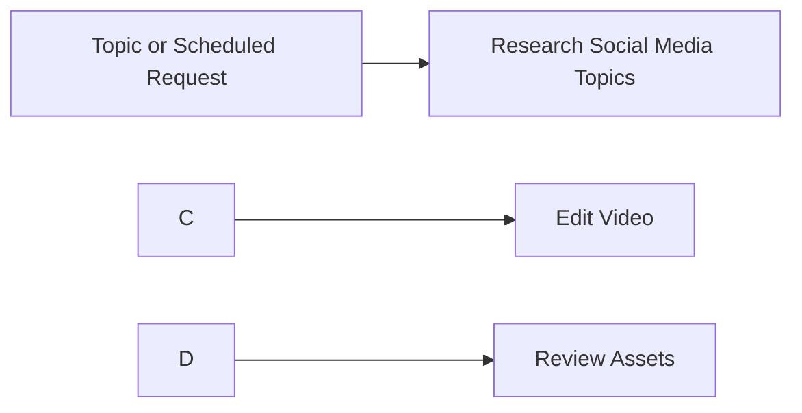

# AI Social Media  Video Editor Automation


An AI-powered social media content production workflow for **topic research, article and  video editing**. Designed to streamline repeatable creative tasks and prepare content assets for multiple social media platforms.

> **Implementation note:** The descriptions below reflect the project's stated capabilities. The exact AI provider, integrations, and editing tools have not been verified from an exported n8n workflow. The banner is a conceptual overview, not evidence of automatic publication or any specific platform integrations.

## Features

- **Video editing:** Assist in editing and preparing video content.

## Workflow Architecture



**Note:** Content ready for publishing is not the same as automatic posting; upload or scheduling integrations are not confirmed.

## Example Deliverables

| Stage | Output |
| --- | --- |
| Editing | Edited video assets |

## Use Cases

- Social media creators and influencers
- Digital marketing and content teams
- Agencies handling multiple brands
- Businesses creating educational or promotional content

## Setup Overview

1. Configure the orchestration platform used in your implementation, such as n8n.
2. Connect video-editing services.
3. Secure API keys using credentials or environment variables; never commit secrets.
4. Configure the workflow trigger and output storage.
5. Run a test content request  edited videos.
6. Review claims, licenses, brand standards and platform requirements before publishing.

## Technology Stack

Workflow-specific integrations and AI models will be listed after examining the exported implementation; the diagram illustrates the conceptual automation stages.

## Repository Structure

```text
Social_Media_Research_Artical_Thumbnail_VideoEditor/
├── README.md
└── assets/
    └── social-media-banner.png
```

## License

Add a license if you intend to specify reuse and distribution rights.
